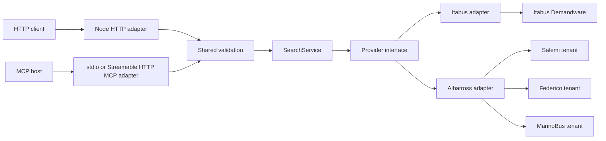

# Architecture

## Goals

The application provides small read-only HTTP and MCP interfaces over incompatible provider systems. Provider knowledge stays local to adapters, aggregate searches tolerate partial failure, and tests exercise the same seams used by production callers.

## Repository map

| Path | Responsibility |
|---|---|
| `src/domain.ts` | Normalized data types and application errors |
| `src/app.ts` | HTTP validation, routing, status selection, and rate limiting |
| `src/mcp/` | Shared MCP tools and stdio process entrypoint |
| `src/rail/` | Live rail booking/status adapters, normalization, and aggregation |
| `src/validation.ts` | Shared inbound search validation |
| `src/rate-limit.ts` | Shared process-local limiter factory |
| `src/search.ts` | Provider selection, concurrency, and partial-result aggregation |
| `src/providers/provider.ts` | Provider contract |
| `src/providers/default.ts` | Default provider composition |
| `src/providers/itabus.ts` | Itabus protocol and normalization |
| `src/providers/albatross.ts` | Shared Salemi, Federico, and MarinoBus protocol |
| `src/providers/flixbus.ts` | FlixBus autocomplete, journey search, and normalization |
| `src/index.ts` | Process configuration and server startup |
| `test/` | Offline behavior tests and synthetic fixtures |
| `docs/` | API, architecture, provider, and operations documentation |

## System context



## Modules and seams

### Domain module

`src/domain.ts` owns normalized `Location`, `Journey`, `SearchInput`, `ProviderError`, and `AppError` definitions. It contains no remote protocol types.

Changing a domain field affects the HTTP interface, every adapter, fixtures, and consumers. Treat it as a breaking-interface decision and update [api.md](api.md).

### HTTP module

`src/app.ts` is the inbound adapter. It:

- accepts a Web `Request`;
- validates method and query parameters;
- enforces the process-local client rate limit;
- invokes `SearchService`;
- selects HTTP status codes;
- serializes safe JSON errors.

`createApp(providers)` is the primary test seam. Tests can replace all remote adapters without starting a socket. `createServer()` is a thin bridge to `node:http`.

### MCP module

`src/mcp/server.ts` keeps the three bus tools over `SearchService` and registers five rail tools over `RailSearchService`, quote adapters, and live adapters. It owns MCP schemas, bounded result presentation, structured content, and safe tool errors. `createBusMcpServer({ providers, railProviders, railLiveProviders })` is its test seam.

`src/mcp/stdio.ts` owns local process transport and shutdown. `src/app.ts` mounts the same server factory at `/mcp` using the SDK's stateless Streamable HTTP handler. The complete interface is in [mcp.md](mcp.md).

### Shared inbound modules

`src/validation.ts` owns the search invariants used by both inbound adapters. `src/rate-limit.ts` creates isolated process-local counters for HTTP clients and MCP search calls. This keeps transport code shallow without duplicating trust-boundary rules.

### Search module

`src/search.ts` is provider-independent orchestration. It selects one or all providers, executes them concurrently with `Promise.all`, converts thrown failures into `ProviderError`, and preserves successful results.

This module owns the partial-result invariant: one provider failure must not erase another provider's data.

### Provider seam

`src/providers/provider.ts` defines the shared adapter interface:

```ts
interface Provider {
  readonly id: string;
  readonly status: ProviderStatus;
  readonly statusReason?: string;
  searchLocations(query: string): Promise<Location[]>;
  searchJourneys(input: SearchInput): Promise<Journey[]>;
}
```

The interface is deliberately small. Callers never receive provider response types or protocol configuration.

### Itabus adapter

`src/providers/itabus.ts` integrates the Demandware endpoints used by Itabus. Its implementation owns:

- parent-city and physical-stop resolution;
- exact matching for journey searches;
- nested fare traversal and cheapest-price selection;
- provider response validation;
- location and journey caches.

### Albatross adapter

`src/providers/albatross.ts` is one implementation configured for three tenants. Its implementation owns:

- origin and destination locality resolution;
- tenant headers and endpoint construction;
- passenger request bodies and child fare lookup;
- multi-leg journey normalization;
- provider response validation;
- per-tenant location, destination, fare, and journey caches.

Thin subclasses contain only stable tenant configuration. Shared behavior stays in `AlbatrossProvider` so a schema fix applies to every tenant.

## Request flow

### Aggregate journey search

1. The inbound adapter validates the future date and passenger counts through `validation.ts`.
2. `SearchService` selects providers and invokes them concurrently.
3. Each adapter resolves provider-specific origin and destination identifiers.
4. Each adapter serves a fresh cached result or makes one timed upstream request.
5. Each adapter validates and normalizes its response into `Journey[]`.
6. `SearchService` combines journeys and provider errors.
7. The HTTP adapter selects a status code; the MCP adapter emits structured content and compact text.

### Trust boundaries

Both inbound parameters and upstream JSON are untrusted. Shared search invariants are validated in `validation.ts`, while transport schemas reject incompatible MCP types. Required upstream fields are checked inside each provider adapter before domain objects are created. Unknown exceptions are reduced to safe errors without returning internal detail.

## State and performance

All state is process-local:

| State | Lifetime |
|---|---:|
| Client request counter | 60 seconds |
| MCP search counter | 60 seconds |
| Successful journey result | 60 seconds |
| Immutable journey snapshot | At most 5 minutes; 32 entries, 1 MiB each |
| Locations, destination catalogs, and fare categories | 1 hour |

Failed upstream requests are not cached. There is no persistent storage, shared cache, queue, or background worker.

Opt-in journey snapshots are separate from provider caches: they freeze the
entire aggregate response, including errors and empty results, under a random
searchId. HTTP and stateless MCP share one SearchSnapshots instance.
Continuation validates the ID/mode and paginates the stored serialization;
it never calls a provider or accepts replacement query fields. Expiry,
eviction and restart require an explicit new search.

Provider instances and their bounded caches are shared by HTTP and MCP in one
process. Each keyed cache holds at most 128 entries; stateless MCP creates only
the protocol instance per exchange. `upstream.ts` bounds response bodies while
reading them, before JSON parsing. Rail stations and journeys come from live
booking APIs; no timetable files or refresh worker are used.

## Test architecture

Tests cross public seams:

- `test/api.test.ts` calls the `createApp` handler as an HTTP client would.
- `test/mcp.test.ts` connects the official MCP client to the server, calls tools, and performs a stdio smoke test.
- `test/search.test.ts` supplies complete `Provider` adapters and verifies aggregation.
- provider tests inject a `Fetcher`, feed synthetic fixtures, and inspect normalized results and outbound requests.

The automated suite is deterministic and offline. Live checks are separate, low-volume research activities documented in gitignored `docs/private/*.hide.md` notes.

## Deliberate constraints

- The runtime uses Node.js platform APIs instead of a web framework.
- Provider URLs are fixed in source code; user input cannot choose an outbound host.
- The service supports one-way searches only.
- Liveness does not imply provider readiness.
- Rate limiting is suitable for a single local process, not a distributed public edge.
- Streamable HTTP is cluster-internal and unauthenticated; no public MCP ingress is implemented.
- `LiveRailProvider` normalizes each operator's booking solutions into the existing journey contract. `RailSearchService` aggregates these live providers and preserves partial results. Failed booking searches never produce theoretical journeys. Live status and boards remain independent; Italo quote state is temporary and cleaned up best-effort.
- Italo In Viaggio is enabled only for standalone train status and boards. Its train status is never joined to a dated schedule because the source cannot prove the service date.
- Connections are returned only when reported by the booking API; the service does not construct routes from timetables or join separate operators.

Production-hardening implications are documented in [operations.md](operations.md).
