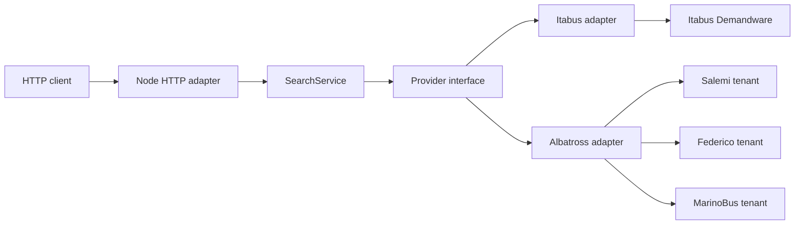

# Architecture

## Goals

The application provides one small read-only interface over incompatible provider systems. Provider knowledge stays local to adapters, aggregate searches tolerate partial failure, and tests exercise the same seams used by production callers.

## Repository map

| Path | Responsibility |
|---|---|
| `src/domain.ts` | Normalized data types and application errors |
| `src/app.ts` | HTTP validation, routing, status selection, and rate limiting |
| `src/search.ts` | Provider selection, concurrency, and partial-result aggregation |
| `src/providers/provider.ts` | Provider contract |
| `src/providers/itabus.ts` | Itabus protocol and normalization |
| `src/providers/albatross.ts` | Shared Salemi, Federico, and MarinoBus protocol |
| `src/index.ts` | Process configuration and server startup |
| `test/` | Offline behavior tests and synthetic fixtures |
| `docs/` | API, architecture, provider, and operations documentation |

## System context



## Modules and seams

### Domain module

`src/domain.ts` owns normalized `Location`, `Journey`, `SearchInput`, `ProviderError`, and `AppError` definitions. It contains no remote protocol types.

Changing a domain field affects the HTTP interface, every adapter, fixtures, and consumers. Treat it as a breaking-interface decision and update [api.md](api.md).

### HTTP module

`src/app.ts` is the inbound adapter. It:

- accepts a Web `Request`;
- validates method and query parameters;
- enforces the process-local client rate limit;
- invokes `SearchService`;
- selects HTTP status codes;
- serializes safe JSON errors.

`createApp(providers)` is the primary test seam. Tests can replace all remote adapters without starting a socket. `createServer()` is a thin bridge to `node:http`.

### Search module

`src/search.ts` is provider-independent orchestration. It selects one or all providers, executes them concurrently with `Promise.all`, converts thrown failures into `ProviderError`, and preserves successful results.

This module owns the partial-result invariant: one provider failure must not erase another provider's data.

### Provider seam

`src/providers/provider.ts` defines the shared adapter interface:

```ts
interface Provider {
  readonly id: string;
  readonly status: ProviderStatus;
  readonly statusReason?: string;
  searchLocations(query: string): Promise<Location[]>;
  searchJourneys(input: SearchInput): Promise<Journey[]>;
}
```

The interface is deliberately small. Callers never receive provider response types or protocol configuration.

### Itabus adapter

`src/providers/itabus.ts` integrates the Demandware endpoints used by Itabus. Its implementation owns:

- parent-city and physical-stop resolution;
- exact matching for journey searches;
- nested fare traversal and cheapest-price selection;
- provider response validation;
- location and journey caches.

### Albatross adapter

`src/providers/albatross.ts` is one implementation configured for three tenants. Its implementation owns:

- origin and destination locality resolution;
- tenant headers and endpoint construction;
- passenger request bodies and child fare lookup;
- multi-leg journey normalization;
- provider response validation;
- per-tenant location, destination, fare, and journey caches.

Thin subclasses contain only stable tenant configuration. Shared behavior stays in `AlbatrossProvider` so a schema fix applies to every tenant.

## Request flow

### Aggregate journey search

1. `app.ts` validates the future date and passenger counts.
2. `SearchService` selects providers and invokes them concurrently.
3. Each adapter resolves provider-specific origin and destination identifiers.
4. Each adapter serves a fresh cached result or makes one timed upstream request.
5. Each adapter validates and normalizes its response into `Journey[]`.
6. `SearchService` combines journeys and provider errors.
7. `app.ts` returns `200` when any journey exists, otherwise `503` when providers reported errors.

### Trust boundaries

Both inbound query parameters and upstream JSON are untrusted. Inbound values are validated in `app.ts`; required upstream fields are checked inside each adapter before domain objects are created. Unknown exceptions are reduced to `PROVIDER_UNAVAILABLE` without returning internal detail.

## State and performance

All state is process-local:

| State | Lifetime |
|---|---:|
| Client request counter | 60 seconds |
| Successful journey result | 60 seconds |
| Locations, destination catalogs, and fare categories | 1 hour |

Failed upstream requests are not cached. There is no persistent storage, shared cache, queue, or background worker.

## Test architecture

Tests cross public seams:

- `test/api.test.ts` calls the `createApp` handler as an HTTP client would.
- `test/search.test.ts` supplies complete `Provider` adapters and verifies aggregation.
- provider tests inject a `Fetcher`, feed synthetic fixtures, and inspect normalized results and outbound requests.

The automated suite is deterministic and offline. Live checks are separate, low-volume research activities documented in [research.md](research.md).

## Deliberate constraints

- The runtime uses Node.js platform APIs instead of a web framework.
- Provider URLs are fixed in source code; user input cannot choose an outbound host.
- The service supports one-way searches only.
- Liveness does not imply provider readiness.
- Rate limiting is suitable for a single local process, not a distributed public edge.

Production-hardening implications are documented in [operations.md](operations.md).
